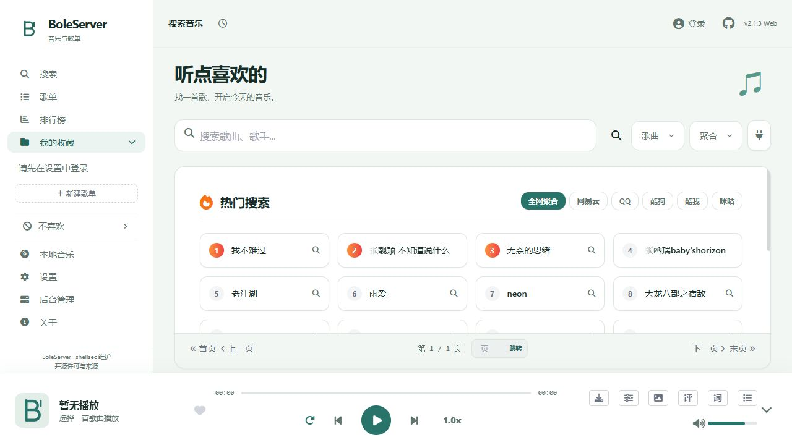
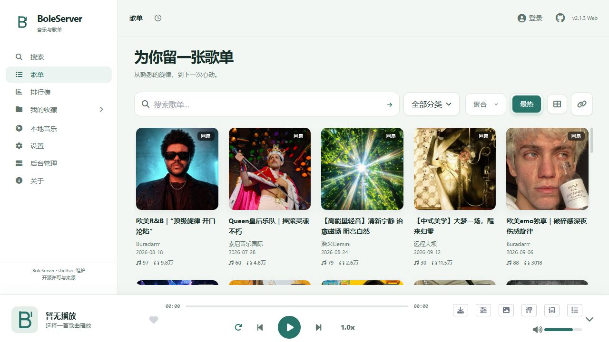
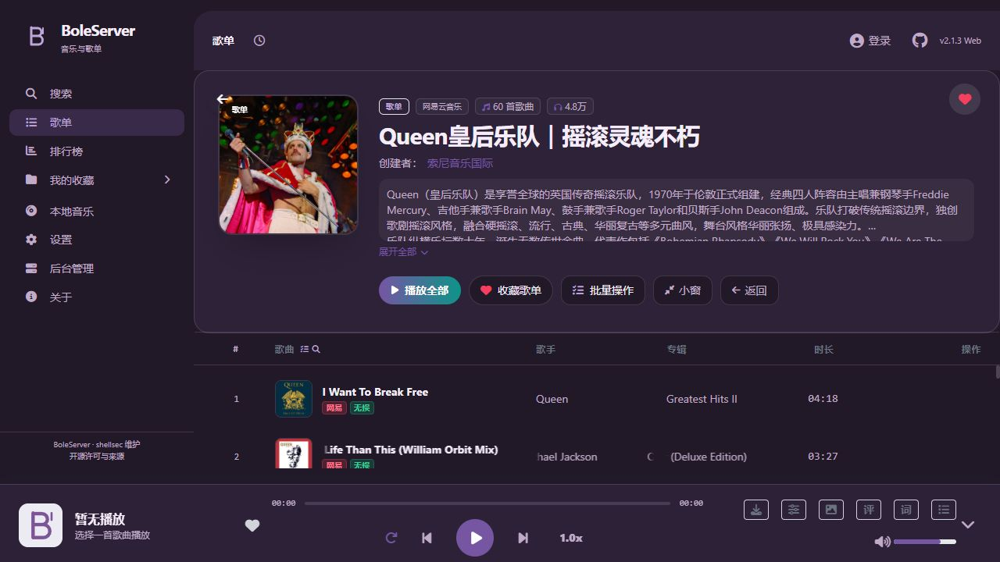
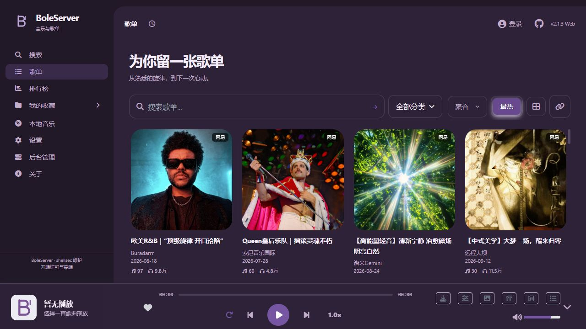
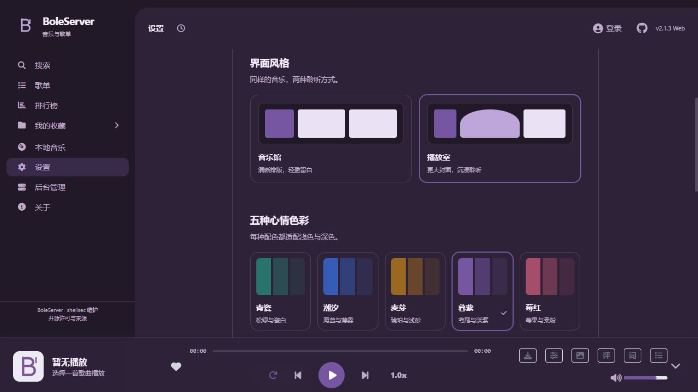
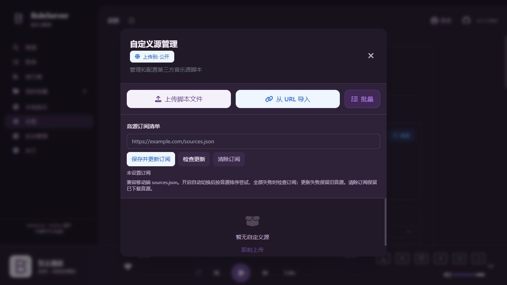
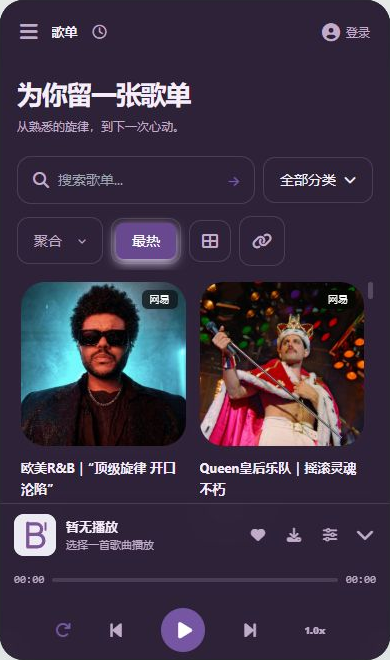
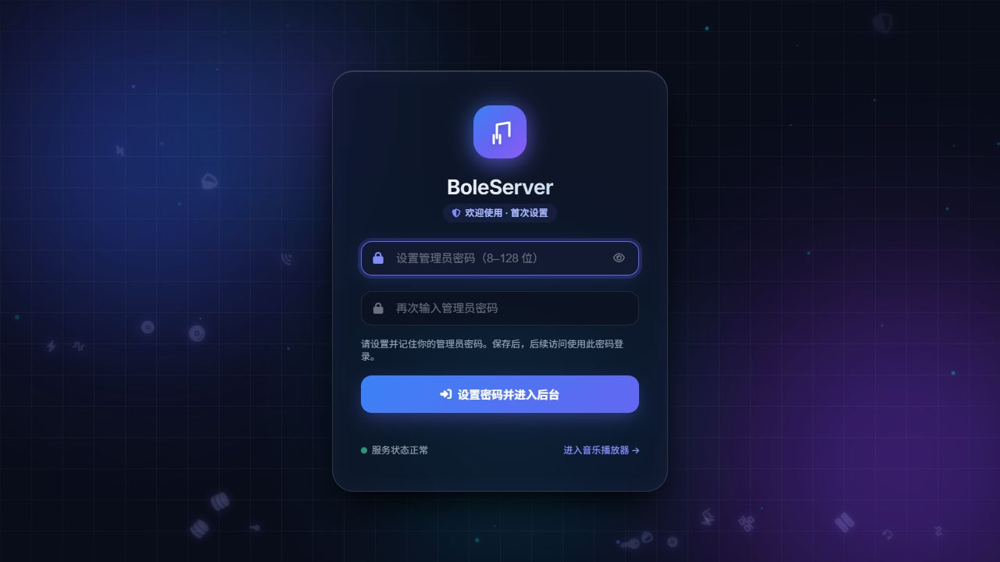

# BoleServer

> BoleServer 是 shellsec 维护的 LX 音源服务版本，基于 [XCQ0607/lxserver](https://github.com/XCQ0607/lxserver)，保留 LX Music 客户端和音源脚本兼容性。原项目版权和 Apache-2.0 许可继续保留。
>
> 新增：[LX 音源订阅与自动切换](md/source-subscriptions.md)。Docker 镜像由本仓库自动构建，使用 `ghcr.io/shellsec/boleserver:latest`，支持 Linux amd64 / arm64。桌面端产物以 Releases 实际发布内容为准。


<div align="center">
  <!--  -->
  <!-- <br>
  <h1>BoleServer</h1> -->
  <p>
    
    
    
    
    <br>
    <br>
    <a href="https://github.com/shellsec/boleserver/stargazers"></a>
    <a href="https://github.com/shellsec/boleserver/network/members"></a>
    <a href="https://github.com/shellsec/boleserver/issues"></a>
    <a href="https://github.com/shellsec/boleserver/commits/main"></a>
    
    <a href="https://github.com/shellsec/boleserver/releases"></a>
  </p>
  <p>
    <a href="https://www.star-history.com/shellsec/boleserver">
      <picture>
        <source media="(prefers-color-scheme: dark)" srcset="https://api.star-history.com/badge?repo=shellsec/boleserver&type=trending&theme=dark" />
        <source media="(prefers-color-scheme: light)" srcset="https://api.star-history.com/badge?repo=shellsec/boleserver&type=trending" />
        
      </picture>
    </a>
  </p>
</div>

[帮助文档 Documentation](https://github.com/shellsec/boleserver/tree/main/docs/) | [同步服务器 SyncServer](md/lxserver.md) | [更新日志 Changelog](changelog.md) | [English](README_EN.md)

---

本项目内置了一个功能强大的 **Web 播放器**，让你可以随时随地在浏览器中享受音乐。同时，它也是一个增强版的 [LX Music 数据同步服务端](md/lxserver.md)。

## ✨ 界面与功能

以下为 2026-10-23 当前 BoleServer 本地版本的实拍截图；在线歌单内容会随平台更新。手机图为 390 × 660 浏览器视口，播放页展示未播放状态。

### 搜索首页与音乐馆

聚合搜索歌曲、歌手与专辑，保留排行榜、收藏和本地音乐入口。音乐馆采用浅色背景与清晰排版。

<p align="center">
  
</p>

### 歌单浏览与详情

浏览多平台网络歌单，查看曲目、歌手和专辑，支持收藏、批量操作与播放队列管理。

<p align="center">
  
  
</p>

### 两种风格、五套配色

内置「音乐馆」与「播放室」，提供青瓷、潮汐、麦芽、暮紫、莓红五套配色，每套适配浅色与深色模式。播放室采用更大的歌单封面。

<p align="center">
  
  
</p>

### LX 音源订阅与自动切换

支持导入 LX 音源脚本和订阅清单；按顺序尝试音源，全部失败后检查订阅更新。详情见 [音源订阅说明](md/source-subscriptions.md)。

填写入口：播放器 → 设置 → 系统 → 自定义源 → 管理员登录 → 管理 / 添加 →「音源订阅清单」。填写 `sources.json` 的完整 HTTP(S) 地址，点击「保存并更新订阅」。这里不是填写歌曲或歌单链接。

<p align="center">
  
</p>

### 手机浏览与播放页

手机浏览器支持歌单双列布局、底部播放控制和全屏播放页。未安装可用音源时，界面截图不代表已验证实际播放。

<p align="center">
  
  
</p>

### 管理后台首次设置

新安装首次访问后台时自行设置管理密码；已有部署保留原密码。后台可管理同步用户、配置、缓存和音源，继续兼容 LX Music 同步与 Subsonic 客户端。

<p align="center">
  
</p>

## 🔒 访问控制与安全

为了保护你的隐私，Web 播放器支持开启访问密码。

### 开启方式

1. **环境变量配置**（推荐 Docker 用户使用）：
   - `ENABLE_WEBPLAYER_AUTH=true`: 开启认证
   - `WEBPLAYER_PASSWORD=yourpassword`: 设置访问密码
2. **Web 界面配置**：
   登录管理后台（默认端口 9527），进入 **"系统配置"**，勾选 **"启用 Web 播放器访问密码"** 并设置密码。

### 权限与公开源限制矩阵 (当 `user.enablePublicRestriction` 开启时)

| 用户类型             | 查看列表 | 使用/切换(仅个人) | 修改默认音质 | 上传/导入公开源 | 删除/修改公开源 |
| :------------------- | :------- | :---------------- | :----------- | :-------------- | :-------------- |
| **管理员**     | ✅ 允许  | ✅ 允许           | ✅ 允许      | ✅ 允许         | ✅ 允许         |
| **已登录用户** | ✅ 允许  | ✅ 允许           | ✅ 允许      | ❌ 禁止         | ❌ 禁止         |
| **未登录访客** | ❌ 隐藏  | ❌ 禁止           | ❌ 禁止      | ❌ 禁止         | ❌ 禁止         |

## 📱 移动端适配

Web 播放器针对移动端进行了深度优化，手机浏览器访问也能获得原生 App 般的体验。

---

## 🚀 快速启动

本项目基于 **Node.js** 开发，支持多种部署方式。

### 方式一：桌面客户端

可以通过桌面端更方便地运行 BoleServer，支持 Windows、macOS 和 Linux。

- **📦 最新版本下载**: [GitHub Releases](https://github.com/shellsec/boleserver/releases/latest)
- **✨ 桌面端优势**:
  - **单窗口管理**: 服务器管理与 Web 播放器合二为一，界面更统一。
  - **托盘常驻**: 窗口关闭后自动缩回托盘，服务在后台始终运行。
  - **全架构支持**: 提供 Windows (x64/x86/ARM64 Setup 及 Portable)、macOS (Intel/Apple Silicon) 及 Linux (amd64/arm64/armv7l) 全家桶。

### 方式二：使用 Docker（推荐）

适用于已安装 **Docker Engine 和 Docker Compose 插件**的 Linux 服务器，支持 amd64 / arm64。首次启动需能访问选用的镜像下载地址。

**国内加速一键安装**（默认安装到 `/opt/boleserver`，脚本下载和镜像拉取均通过 gh-proxy.com）：

```bash
curl -fsSL https://gh-proxy.com/https://raw.githubusercontent.com/shellsec/boleserver/main/deploy/install.sh -o /tmp/boleserver-install.sh && sudo env BOLE_IMAGE=gh-proxy.com/docker/ghcr.io/shellsec/boleserver:latest bash /tmp/boleserver-install.sh
```

已是 root 用户时去掉 `sudo` 即可。`gh-proxy.com` 为第三方加速服务；如无法访问或希望直连，使用下方官方命令。镜像加速地址会保存在安装目录的 `.env`，后续升级继续使用。

**官方直连安装**：

```bash
curl -fsSL https://raw.githubusercontent.com/shellsec/boleserver/main/deploy/install.sh -o /tmp/boleserver-install.sh && sudo bash /tmp/boleserver-install.sh
```

脚本检查 Docker、拉取镜像、创建持久化目录并启动服务，健康检查成功后显示后台地址。不会安装 Docker 或更改防火墙。自定义安装目录可在命令末尾添加目录，例如 `/opt/my-boleserver`。

首次打开 `http://服务器IP:9527/admin/`，输入两次自己选择的管理员密码（8–128 位），保存后进入后台。**没有默认管理密码，也不需要查找随机密码。** 密码保存在挂载的 `data/config.js`，容器重启、升级后仍保留。已有部署继续使用原密码。

登录后可在「系统配置 → 管理员密码」修改密码，在「用户管理」添加同步用户。音源入口是「播放器 → 设置 → 系统 → 管理员登录 → 管理 / 添加 → 音源订阅清单」，填写 LX `sources.json` 地址并保存；也可上传音源脚本。

**手动 Compose 部署**：

```bash
mkdir -p /opt/boleserver && cd /opt/boleserver
curl -fsSL https://gh-proxy.com/https://raw.githubusercontent.com/shellsec/boleserver/main/deploy/compose.yaml -o compose.yaml
printf 'BOLE_IMAGE=gh-proxy.com/docker/ghcr.io/shellsec/boleserver:latest\n' > .env
mkdir -p data cache music cover_cache
sudo chown 1000:1000 data cache music cover_cache
docker compose pull
docker compose up -d
docker compose logs -f
```

镜像：`ghcr.io/shellsec/boleserver:latest`；端口：`9527`。Compose 示例见 [deploy/compose.yaml](deploy/compose.yaml)。`data/` 保存密码、用户配置和音源；日志位于 `data/logs/`；`cache/`、`music/`、`cover_cache/` 为持久化文件。

标准配置不设置 `ADMIN_PASSWORD`，方便在后台修改密码。如果手动设置了它，环境变量具有最高优先级，后台将禁止修改管理密码，需修改部署环境后重新创建容器。播放器访问密码独立，可在后台设置。

**升级**：先备份数据目录与 Compose 文件，然后执行：

```bash
cd /opt/boleserver
docker compose pull
docker compose up -d
```

升级保留数据和密码；不要删除数据目录。`latest` 跟随 main 分支通过测试的构建，也可使用镜像包页面上的 `sha-` 标签固定版本。现有本地镜像部署需先将 Compose 中 `image` 改为上述 GHCR 地址；仓库推送和镜像发布不会自动升级运行中的服务。

**从源码构建**（可选，无需在宿主机安装 Node.js）：

```bash
git clone https://github.com/shellsec/boleserver.git
cd boleserver
docker build -t boleserver:local .
```

忘记管理密码时，停止容器并在服务器重置为自选密码（执行时不会回显密码）：

```bash
cd /opt/boleserver
docker compose stop
read -rsp '新的管理员密码（8–128 位）: ' BOLE_NEW_PASSWORD; echo
export BOLE_NEW_PASSWORD
docker compose run --rm -e BOLE_NEW_PASSWORD --entrypoint node boleserver -e '
const fs = require("fs");
const p = process.env.BOLE_NEW_PASSWORD;
if (!p || p.trim().length < 8 || p.length > 128) throw new Error("密码长度需为 8–128 位");
const file = "/server/data/config.js";
const c = require(file); c["admin.password"] = p;
fs.writeFileSync(file, "module.exports = " + JSON.stringify(c, null, 2), { mode: 0o600 });'
unset BOLE_NEW_PASSWORD
docker compose up -d
```

如果设置了 `ADMIN_PASSWORD`，应直接修改该环境变量后执行 `docker compose up -d --force-recreate`。

### 方式三：直接运行 (Git Clone)

```bash
# 1. 克隆项目
git clone https://github.com/shellsec/boleserver.git && cd boleserver

# 2. 安装依赖并编译
npm ci && npm run build

# 3. 启动服务
npm start
```

### 方式四：使用 Release 版本

1. 在 GitHub Releases 下载压缩包。
2. 解压后运行 `npm install --production`。
3. 执行 `npm start` 启动。

### 3. 服务连接与客户端配置指南

#### ① Web 界面访问

- **Web 播放器**: `http://<服务器IP>:9527`（默认根路径，可通过 `PLAYER_PATH` 环境变量或后台配置自定义路径，如 `/music`）
  - 若启用了播放器访问密码认证（`ENABLE_WEBPLAYER_AUTH`），首次访问需输入播放器密码（默认 `123456`）。
- **管理后台**: `http://<服务器IP>:9527/admin`（默认路径为 `/admin`，可通过 `ADMIN_PATH` 自定义，首次访问设置管理员密码，已有部署使用原密码）。

#### ② LX Music 客户端同步配置（桌面端 / 移动端）

进入客户端「设置 → 同步设置」，选择自定义连接：

- **模式一：用户路径模式（推荐，默认开启 `USER_ENABLE_PATH=true`）**
  - **连接 URL**: `http://<服务器IP>:9527/<用户名>`（例如：`http://192.168.1.100:9527/user1`）
  - **连接密码**: 对应用户的独立密码
  - **特点**: 通过 URL 中的用户名精确路由到各用户独立存储空间，**允许多个不同用户使用相同密码**。
- **模式二：根路径模式（需配置 `USER_ENABLE_ROOT=true`）**
  - **连接 URL**: `http://<服务器IP>:9527`（例如：`http://192.168.1.100:9527`）
  - **连接密码**: 对应用户的密码
  - **特点**: URL 无需携带用户名，服务端通过鉴权密码自动匹配用户。**注意：此模式下所有用户的密码必须唯一，不允许不同用户使用相同密码**。

#### ③ Subsonic 音乐客户端配置（音流 / Feishin / Symfonium 等）

全面兼容 Subsonic API 协议，客户端中填写：

- **服务器地址 (Server URL)**:
  - **默认共享主端口**: `http://<服务器IP>:9527/rest`（子路径由 `SUBSONIC_PATH` 决定，默认 `/rest`）
  - **独立监听端口模式**（若配置了 `SUBSONIC_PORT` > 0，例如 `4533`）: `http://<服务器IP>:4533/rest`
- **用户名 & 密码**: 在后台“用户管理”中配置的用户名及其同步密码。
- **在线搜索**: 支持在 Subsonic 客户端中直接全网搜索与播放，可使用 `wy:`、`tx:`、`kw:`、`kg:`、`mg:` 指定平台，或使用 `online:` / `local:` 强制在线/本地搜索。

---

## 🏗️ 项目架构

本项目基于 Node.js 采用前后端分离架构：

- **Backend (Express + WebSocket)**: 核心同步逻辑与 WebDAV 备份。
- **WebPlayer (Vanilla JS)**: 负责音乐播放业务，默认访问路径为根路径 `/`。
- **Console (Vanilla JS)**: 位于 `/admin` 路径，负责用户与数据管理。

---

## 🛠️ 配置说明

系统配置文件已默认持久化在数据目录中的 `data/config.js`（Docker 部署只需挂载 `./data` 卷即可在容器更新、重启后永久保留配置，若根目录下存在旧 `config.js` 会自动平滑迁移）。环境变量优先级最高：

| 环境变量                                     | 对应配置项                                   | 说明                                                                                               | 默认值               |
| -------------------------------------------- | -------------------------------------------- | -------------------------------------------------------------------------------------------------- | -------------------- |
| `PORT`                                     | `port`                                     | 服务端口                                                                                           | `9527`             |
| `ADMIN_PATH`                               | `admin.path`                               | 后台管理界面访问路径                                                                               | `/admin`           |
| `PLAYER_PATH`                              | `player.path`                              | Web 播放器访问路径 (默认为根路径 `/`)                                                            | `/`                |
| `ADMIN_PASSWORD`                           | `admin.password`                           | 管理员密码；设置后由环境变量管理，后台不可修改                                                 | 首次后台设置           |
| `SERVER_NAME`                              | `serverName`                               | 同步服务名称（客户端连接展示名称及管理后台标题）                                                   | `BoleServer`   |
| `PLAYER_NAME`                              | `player.name`                              | Web 播放器名称（播放器网页标题及登录卡片标题）                                                     | `BoleServer`     |
| `ENABLE_DEBUG`                             | `debug.enabled`                            | 是否启用 DEBUG 模式 (开启后输出详细调试日志与音源内部日志，默认关闭)                               | `false`            |
| `MAX_SNAPSHOT_NUM`                         | `maxSnapshotNum`                           | 保留的最大快照数量                                                                                 | `10`               |
| `CONFIG_PATH`                              | -                                            | 指定外部配置文件的绝对路径 (默认使用 `data/config.js`)                                           | -                    |
| `DATA_PATH`                                | -                                            | 指定数据存储目录的绝对路径                                                                         | `./data`           |
| `LOG_PATH`                                 | -                                            | 指定日志输出目录的绝对路径                                                                         | `./logs`           |
| `PROXY_HEADER`                             | `proxy.header`                             | 代理转发 IP 头 (如 `x-real-ip`)                                                                  | -                    |
| `USER_ENABLE_ROOT`                         | `user.enableRoot`                          | 启用根路径 (开启后连接URL即为 `ip:port`，不允许不同用户密码相同)                                 | `false`            |
| `USER_ENABLE_PATH`                         | `user.enablePath`                          | 启用用户路径 (开启后连接URL需为 `ip:port/用户名`，允许密码相同)                                  | `true`             |
| `WEBDAV_ENABLE`                            | `webdav.enable`                            | 是否启用 WebDAV 同步与备份                                                                         | `false`            |
| `WEBDAV_URL`                               | `webdav.url`                               | WebDAV 地址                                                                                        | -                    |
| `WEBDAV_USERNAME`                          | `webdav.username`                          | WebDAV 用户名                                                                                      | -                    |
| `WEBDAV_PASSWORD`                          | `webdav.password`                          | WebDAV 密码                                                                                        | -                    |
| `WEBDAV_SYNC_PATH`                         | `webdav.syncPath`                          | WebDAV 增量同步远端路径                                                                            | `/lx-sync`         |
| `WEBDAV_BACKUP_PATH`                       | `webdav.backupPath`                        | WebDAV 全量备份远端路径                                                                            | `/lx-sync-backups` |
| `SYNC_INTERVAL`                            | `sync.interval`                            | WebDAV 增量同步检测间隔(分钟)                                                                      | `60`               |
| `BACKUP_INTERVAL`                          | `sync.backupInterval`                      | WebDAV 全量备份间隔(小时)                                                                          | `24`               |
| `WEBDAV_EXCLUDE_CACHE`                     | `webdav.excludeCache`                      | 排除缓存目录同步 (`data/<用户>/cache`)，开启后不参与增量同步及全量备份（已同步的文件不会被删除） | `false`            |
| `WEBDAV_EXCLUDE_MUSIC`                     | `webdav.excludeMusic`                      | 排除下载目录同步 (`data/<用户>/music`)，开启后不参与增量同步及全量备份（已同步的文件不会被删除） | `false`            |
| `ENABLE_WEBPLAYER_AUTH`                    | `player.enableAuth`                        | 是否启用 Web 播放器访问密码                                                                        | `false`            |
| `WEBPLAYER_PASSWORD`                       | `player.password`                          | Web 播放器访问密码                                                                                 | `123456`           |
| `DISABLE_TELEMETRY`                        | `disableTelemetry`                         | 是否禁用匿名数据统计，系统更新提示以及系统公告提示                                                 | `false`            |
| `ENABLE_PUBLIC_USER_RESTRICTION`           | `user.enablePublicRestriction`             | 是否启用公开用户权限限制 (限制上传、删除公开源、缓存到服务器等)                                    | `true`             |
| `ENABLE_PUBLIC_NON_ADMIN_LOCAL_MUSIC`      | `user.enablePublicNonAdminLocalMusic`      | 是否开启非管理员访问本地音乐 (允许未登录管理员的公开账号访问本地音乐)                              | `false`            |
| `ENABLE_PUBLIC_NON_ADMIN_BROWSER_DOWNLOAD` | `user.enablePublicNonAdminBrowserDownload` | 是否开启非管理员浏览器下载 (允许未登录管理员的公开/普通账号使用浏览器下载歌曲)                     | `true`             |
| `ENABLE_PUBLIC_NON_ADMIN_SERVER_CACHE`     | `user.enablePublicNonAdminServerCache`     | 是否开启非管理员服务器缓存 (允许未登录管理员的公开/普通账号将歌曲缓存到服务器)                     | `false`            |
| `ENABLE_PUBLIC_FAVORITES`                  | `user.enablePublicFavorites`               | 是否开启公开收藏和歌曲 (开启后允许公开/未登录用户查看及播放公开收藏)                               | `false`            |
| `ENABLE_PUBLIC_NON_ADMIN_ACCESS`           | `user.enablePublicNonAdminAccess`          | 是否开启非管理员访问公开收藏和歌曲 (允许未登录管理员的公开账号查看)                                | `false`            |
| `ENABLE_CUSTOM_MUSIC_DIR`                  | `user.enableCustomMusicDir`                | 是否开启自定义歌曲目录总开关                                                                       | `false`            |
| `ENABLE_LOGIN_USER_CACHE_RESTRICTION`      | `user.enableLoginCacheRestriction`         | 是否启用登录用户缓存限制 (开启后限非管理员登录用户的缓存设置)                                      | `false`            |
| `ENABLE_CACHE_SIZE_LIMIT`                  | `user.enableCacheSizeLimit`                | 是否启用缓存空间限制 (开启后超出容量将按 LRU 自动清理)                                             | `false`            |
| `CACHE_SIZE_LIMIT`                         | `user.cacheSizeLimit`                      | 缓存空间限制大小 (单位: MB)                                                                        | `2000`             |
| `CONFIG_BACKUP_ENABLE`                     | `configBackup.enable`                      | 是否启用配置文件自动备份功能 (每天生成一份历史配置副本)                                            | `true`             |
| `CONFIG_BACKUP_RETENTION_DAYS`             | `configBackup.retentionDays`               | 配置文件备份保留天数 (自动清理过期备份)                                                            | `7`                |
| `CONFIG_BACKUP_DIR`                        | `configBackup.dir`                         | 配置文件备份存储目录路径 (支持绝对路径或相对 `./data`)                                           | `backups`          |
| `SNAPSHOT_BACKUP_PATH`                     | `snapshot.backupPath`                      | 歌单快照自定义存储路径 (支持绝对路径或相对 `./data`，各用户独立隔离)                             | -                    |
| `LIST_ADD_MUSIC_LOCATION_TYPE`             | `list.addMusicLocationType`                | 添加歌曲到列表时的位置 (`top` / `bottom`)                                                      | `top`              |
| `PROXY_ALL_ENABLED`                        | `proxy.all.enabled`                        | 是否启用外发请求代理 (针对 Music SDK)                                                              | `false`            |
| `PROXY_ALL_ADDRESS`                        | `proxy.all.address`                        | 代理地址 (支持 http:// 或 socks5://)                                                               | -                    |
| `SINGER_SOURCE_PRIORITY`                   | `singer.sourcePriority`                    | 歌手信息获取来源优先级 (如 `tx,wy` 或 `wy,tx`)                                                 | `tx,wy`            |
| `SUBSONIC_ENABLE`                          | `subsonic.enable`                          | 是否启用 Subsonic 协议支持                                                                         | `true`             |
| `SUBSONIC_PATH`                            | `subsonic.path`                            | Subsonic 接口访问路径 (默认为 `/rest`)                                                           | `/rest`            |
| `SUBSONIC_PORT`                            | `subsonic.port`                            | Subsonic 独立监听端口 (`0` 为关闭独立端口，与主服务共用端口)                                     | `0`                |
| `SUBSONIC_ENABLE_DEBUG`                    | `subsonic.enableDebug`                     | 是否开启 Subsonic 调试日志模式                                                                     | `false`            |
| `SUBSONIC_ONLINE_SEARCH`                   | `subsonic.onlineSearch`                    | 是否开启 Subsonic 在线全网搜索                                                                     | `true`             |
| `SUBSONIC_ONLINE_SEARCH_MODE`              | `subsonic.onlineSearchMode`                | Subsonic 在线搜索模式 (`fallback` / `merge` / `local_only`)                                  | `fallback`         |
| `SUBSONIC_ONLINE_SEARCH_SOURCES`           | `subsonic.onlineSearchSources`             | Subsonic 在线搜索默认音源列表                                                                      | `wy,tx,kw,kg,mg`   |
| `SUBSONIC_PUBLIC_LEADERBOARDS`             | `subsonic.publicLeaderboards`              | 是否开启 Subsonic 公开排行榜 (将在线排行榜映射为只读歌单)                                          | `true`             |
| `SUBSONIC_LEADERBOARD_SOURCE`              | `subsonic.leaderboardSource`               | Subsonic 公开排行榜默认音源平台 (仅支持单选, 如 `tx`, `wy` 等)                                 | `tx`               |
| `SUBSONIC_LYRIC_TRANSLATION`               | `subsonic.lyricTranslation`                | Subsonic 歌词中是否包含翻译                                                                        | `true`             |
| `SUBSONIC_CACHE_ON_PLAY`                   | `subsonic.cacheOnPlay`                     | Subsonic 播放时是否触发服务器自动缓存保存 (落盘到用户目录)                                         | `false`            |
| `SUBSONIC_PLAY_CACHE_FIRST`                | `subsonic.playCacheFirst`                  | Subsonic 播放时是否优先使用服务器已有的本地缓存/下载文件直接传输                                   | `true`             |
| `SUBSONIC_QUALITY_ENABLED`                 | `subsonic.quality.enabled`                 | Subsonic 是否开启音质优选                                                                          | `true`             |
| `SUBSONIC_QUALITY_PRIORITY`                | `subsonic.quality.priority`                | Subsonic 音质优选优先级列表 (如 `flac,320k,128k`)                                                | `flac,320k,128k`   |
| `ARTIST_MAX_FETCH_PAGES`                   | `artist.maxFetchPages`                     | 歌手歌曲最大抓取页数                                                                               | `20`               |
| `CACHE_NAMING_PATTERN`                     | `cache.namingPattern`                      | 缓存文件命名规则 (`simple` / `custom`)                                                         | `simple`           |
| `SYSTEM_ALLOW_UNSAFE_VM`                   | `system.allowUnsafeVM`                     | 是否允许运行 VM 模式自定义源脚本 (需注意安全风险)                                                  | `false`            |
| `LX_USER_<用户名>`                         | `users` 数组                               | 快速添加用户，值为该用户的密码 (如 `LX_USER_test=123`)                                           | -                    |

> **高级用户配置说明**：环境变量 `LX_USER_<用户名>` 仅用于快速添加用户及设置密码。若需为特定用户配置独立的高级选项（如开启个人自定义音乐目录、分配操作权限 `allowOperateCustomMusicDir` 或写入权限 `allowWriteCustomMusicDir`、调整快照数量等），请直接在 `config.js` 的 `users` 数组中手动配置对应字段，或者在后台管理界面的“用户管理”面板中通过图形界面修改。

> **布尔类型环境变量说明**：所有布尔类型的环境变量支持灵活的写法（不区分大小写），开启支持 `true` / `1` / `yes` / `y` / `on`；关闭支持 `false` / `0` / `no` / `n` / `off`。

> **提示**：目前服务支持 `启用根路径` (URL配置为 `ip:port`) 和 `启用用户路径` (URL配置为 `ip:port/username`) 两种数据同步连接方式。如果没有启用用户路径，则必须保证每一个同步用户的鉴权密码不重复。

---

## 🛡️ 数据收集与隐私说明

本项目集成了 PostHog 匿名数据统计，主要用于：

1. **Bug 追踪**: 收集版本号、环境类型。
2. **通知推送**: 弹出 **版本更新提醒** 与 **紧急维护公告**。

- **绝对匿名**: 绝不收集 IP、用户名或具体歌单内容。
- **关闭方法**: 环境变量设置 `DISABLE_TELEMETRY=true`。**注意：关闭后将无法收到新版本通知。**

---

## 🤝 贡献与致谢

- 修改自 [lyswhut/lx-music-sync-server](https://github.com/lyswhut/lx-music-sync-server)。
- Web 播放器逻辑参考 [lx-music-desktop](https://github.com/lyswhut/lx-music-desktop)。

### 👥 贡献者 (Contributors)

<a href="https://github.com/shellsec/boleserver/graphs/contributors">
  
</a>

## 📈 Star History

<a href="https://www.star-history.com/?repos=shellsec%2Fboleserver&type=timeline&logscale=&releases=&legend=bottom-right">
 <picture>
   <source media="(prefers-color-scheme: dark)" srcset="https://api.star-history.com/chart?repos=shellsec/boleserver&type=timeline&theme=dark&logscale&legend=bottom-right" />
   <source media="(prefers-color-scheme: light)" srcset="https://api.star-history.com/chart?repos=shellsec/boleserver&type=timeline&logscale&legend=bottom-right" />
   
 </picture>
</a>

## 📄 开源协议

本项目基于 Apache License 2.0 许可证发行，以下协议是对于 Apache License 2.0 的补充，如有冲突，以以下协议为准。

Apache License 2.0 copyright (c) 2026 [xcq0607](https://github.com/xcq0607)

**词语约定**：本协议中的“本项目”指 BoleServer 播放器；“使用者”指签署本协议的使用者；“官方音乐平台”指对本项目内置的包括酷我、酷狗、咪咕等音乐源的官方平台统称；“版权数据”指包括但不限于图像、音频、名字等在内的他人拥有所属版权的数据。

### 一、数据来源

1. **官方平台**: 本项目的各官方平台在线数据来源原理是从其公开服务器中拉取数据，经过对数据简单地筛选与合并后进行展示(与未登录状态在官方APP获取的数据相同)，因此本项目不对数据的合法性、准确性负责。
2. **音频数据**: 本项目本身没有获取某个音频数据的能力，所使用的在线音频数据来源来自设置内“自定义源”所选择的“源”返回的在线链接。本项目无法校验其准确性，使用过程中可能会出现播放异常。
3. **其他数据**: 本项目的非官方平台数据（例如“我的列表”内列表）来自服务器存储数据，本项目不对这些数据的合法性、准确性负责。

### 二、免责声明

1. **版权数据**: 使用本项目的过程中可能会产生版权数据。对于这些版权数据，本项目不拥有它们的所有权。为了避免侵权，使用者务必在 **24 小时内** 清除使用本项目的过程中所产生的版权数据。
2. **责任承担**: 由于使用本项目产生的包括由于本协议或由于使用或无法使用本项目而引起的任何性质的任何直接、间接、特殊、偶然或结果性损害由使用者负责。
3. **法律法规**: 本项目完全免费，且开源发布于 GitHub 面向全世界人用作对技术的学习交流。**禁止**在违反当地法律法规的情况下使用本项目。对于使用者在明知或不知当地法律法规不允许的情况下使用本项目所造成的任何违法违规行为由使用者承担。

### 三、其他

1. **资源使用**: 本项目内使用的部分包括但不限于字体、图片等资源来源于互联网。如果出现侵权可联系本项目移除。
2. **非商业性质**: 本项目仅用于对技术可行性的探索及研究，不接受任何商业（包括但不限于广告等）合作及捐赠。
3. **接受协议**: 若你使用了本项目，即代表你接受本协议。
